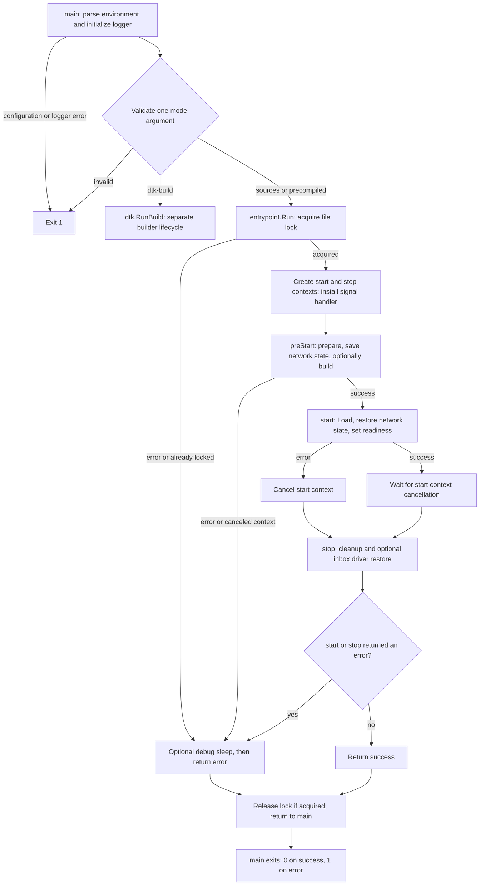
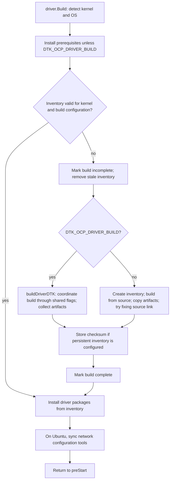
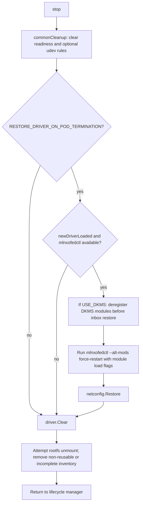

<!-- Copyright 2026 NVIDIA CORPORATION & AFFILIATES -->

# Go entrypoint flow

This guide describes the Go entrypoint in this revision. The Mermaid diagrams
render directly on GitHub. They show orchestration and branch decisions; individual
OS commands and non-fatal diagnostics are summarized. When changing the lifecycle,
update these diagrams alongside the linked source.

## Mode selection and lifecycle

[loader.sh](../loader.sh) defaults `USE_NEW_ENTRYPOINT` to `true` and executes the
Go binary with the container arguments. Setting it to `false` selects the legacy
[entrypoint.sh](../entrypoint.sh), which is outside this guide.

Sources: [main](../entrypoint/cmd/main.go),
[configuration](../entrypoint/internal/config/config.go), and
[lifecycle manager](../entrypoint/internal/entrypoint/entrypoint.go).

A `preStart` failure does **not** call `stop`, including a build failure. Once
`start` is called, `stop` runs whether startup succeeds or fails. The debug delay
is controlled by `ENTRYPOINT_DEBUG` and `DEBUG_SLEEP_SEC_ON_EXIT`; the lock remains
held during that delay if it was acquired.

For `sources` and `precompiled`, SIGINT/SIGTERM cancels the first context that is
not already canceled: first startup/wait, then teardown. A further signal when
both are canceled calls `os.Exit(1)` immediately, bypassing deferred cleanup and
unlocking. Cancellation during `preStart` follows its error path rather than
forcing teardown. If startup fails and cancels its own context, the next signal
cancels teardown.

## Preparation and build

`preStart` runs these steps in order, returning immediately on a propagated error:

1. Collect optional debug information; `commonCleanup` removes readiness and,
   when `CREATE_IFNAMES_UDEV` is enabled, old naming rules.
2. `driver.PreStart` prepares the environment (including optional DKMS/FIPS
   setup). In `sources` mode it validates the source path, prepares GCC, and
   validates the configured inventory directory.
3. `handleKernelModules` unloads unused `nvidia_peermem` and rejects loaded storage
   or third-party RDMA modules unless their respective unload option is enabled.
4. `netconfig.Save` records network state, then `createUDEVRulesIfRequired`
   preserves old interface naming when enabled and needed.
5. In `sources` mode, `driver.Build` follows the diagram below. `precompiled`
   skips this step. Finally, check the startup context for cancellation.

Sources: [driver manager](../entrypoint/internal/driver/driver.go),
[DTK client](../entrypoint/internal/driver/driver_dtk.go), and
[network configuration](../entrypoint/internal/netconfig/netconfig.go).

A cache hit still installs packages. For non-DTK builds, prerequisites are
installed before checking the cache because DKMS may need kernel headers.
Propagated errors anywhere in this diagram return through `preStart` and skip
`stop`; the source-link repair is a non-fatal exception.

The `dtk-build` mode runs [dtk.RunBuild](../entrypoint/internal/dtk/build.go)
in a separate container: validate DTK settings, install dependencies, wait for the
start flag, run `install.pl`, create the done flag, try removing the start flag,
then wait for cancellation. It does not run the driver's lock/preStart/start/stop
lifecycle or set driver readiness. SIGINT/SIGTERM cancels its single context;
`RunBuild` returns the context error (including after a completed build), which
`main` handles as exit 1. Another signal after cancellation exits immediately.

## Loading and teardown

Sources: [start/stop](../entrypoint/internal/entrypoint/entrypoint.go) and
[Load/Unload/Clear](../entrypoint/internal/driver/driver.go).

`driver.Load` creates a temporary module blacklist and defers its removal. It
sets up DKMS when enabled, then compares loaded module source versions with the
candidate modules. A mismatch triggers `restartDriver` and sets `newDriverLoaded`;
matching versions skip the restart. It then mounts the shared root filesystem,
optionally installs NFS userspace tools, and attempts inventory cleanup.

On success, `Load` currently returns `true` even when module versions matched.
Consequently, `start` calls `netconfig.Restore` on every successful `Load`, then
sets readiness. This return value differs from `newDriverLoaded`, which controls
whether `Unload` attempts an inbox driver restore.

Each propagated teardown error returns immediately, so subsequent steps may not
run. `Clear` logs some failures (such as unmount failure) and continues; inventory
removal failure is returned. When inbox restoration is disabled, the current
driver stays loaded but `Clear` still runs. Readiness is set only after successful
startup and cleared at the beginning of teardown.
