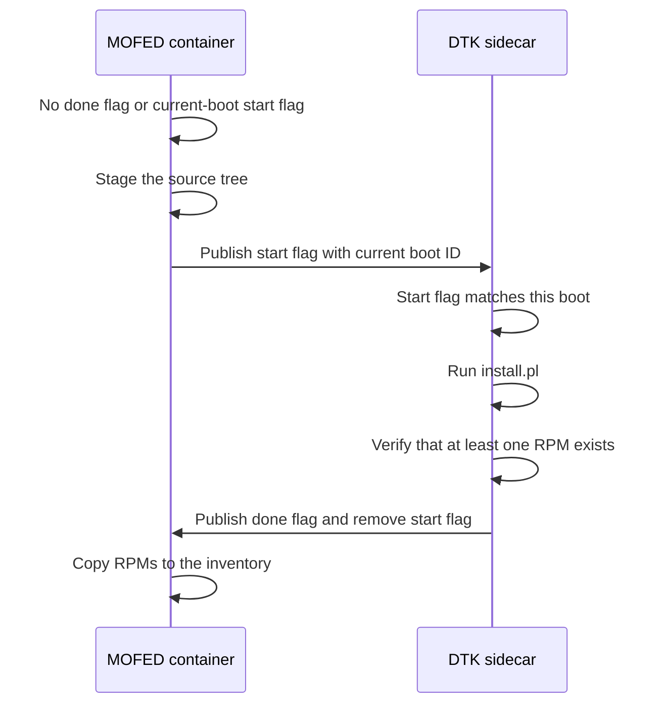
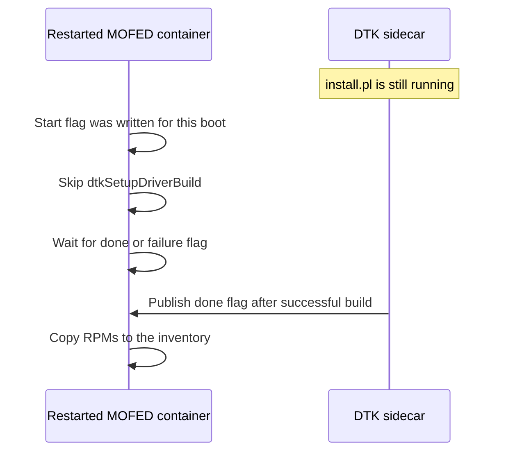
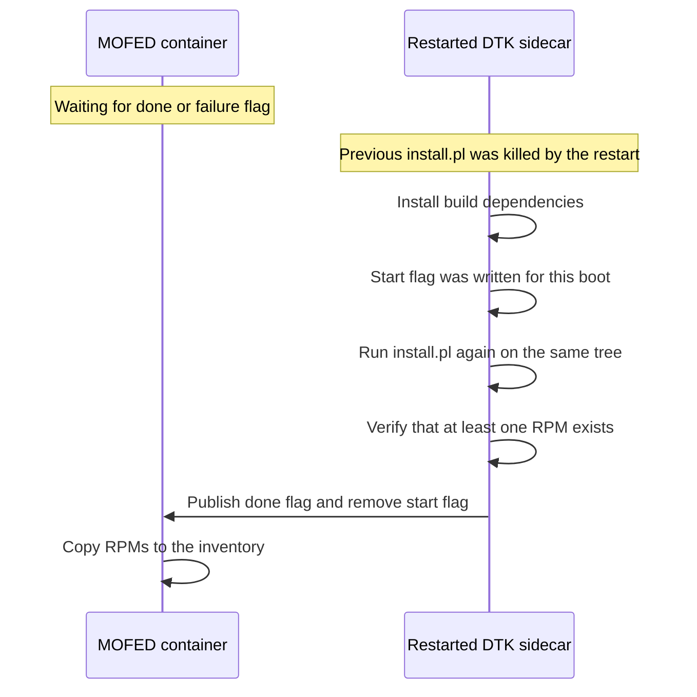
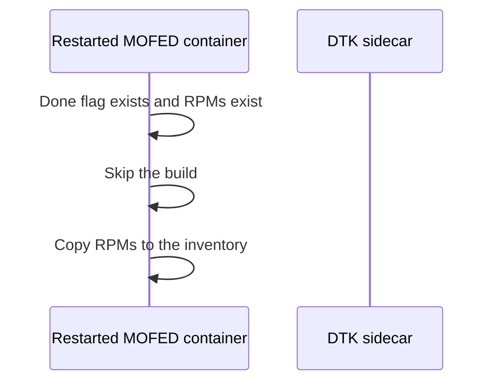
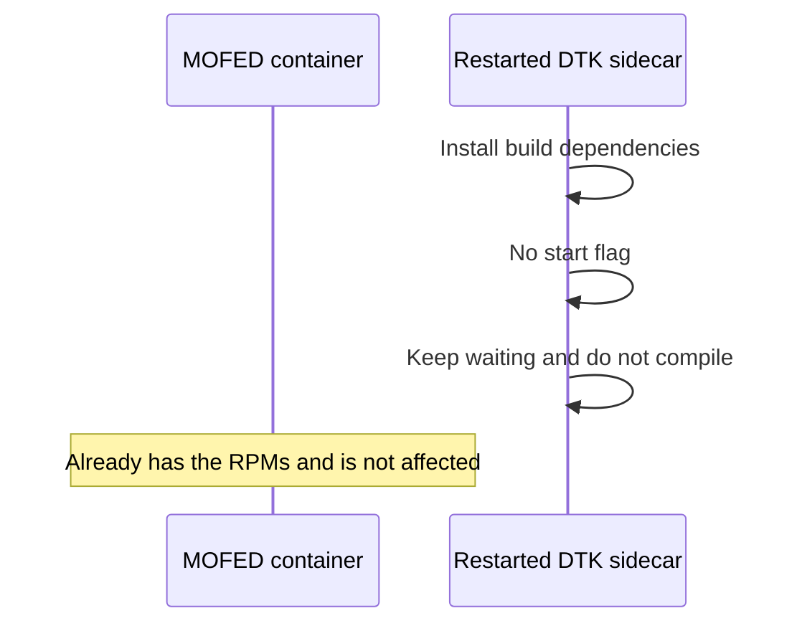

# DTK Build and Restart Flows

## Components and shared state

The MOFED container prepares the build and consumes its output. The DTK sidecar
runs `install.pl`. Both containers use the same shared directory.

- `dtk_start_compile`: contains the node boot ID and asks the sidecar to compile.
- `dtk_compile_done_*`: records that the build command succeeded and at least one
  RPM was found.
- `dtk_compile_failed`: records that the build completed without producing an RPM.

The start flag does not mean that the build is complete or that RPMs exist. It
only means that a compile was requested during the boot identified by its
contents.

## First build

## MOFED container restarts during compilation

The done flag does not exist yet, but the start flag still contains the current
boot ID. The restarted MOFED container therefore skips setup. In particular, it
does not remove and replace the source tree while the sidecar is compiling it.

If the resumed build publishes the failure flag, the MOFED container stages the
source tree once and starts a second build attempt.

## DTK sidecar restarts during compilation

The restart kills the running `install.pl`. The start flag and source tree
remain in the shared directory, and no done flag exists yet. The restarted
sidecar sees that the flag was written for the current boot and runs
`install.pl` again from the beginning on the same tree. The MOFED container is
not affected and continues waiting for either the done or failure flag.

If the new run produces no RPM, the sidecar publishes the failure flag and the
MOFED container stages the tree once more, as in the no-RPM flow below.

## Restart after successful compilation

The done flag and RPMs remain in the shared directory, and the start flag was
removed after success.

### MOFED container restarts

### DTK sidecar restarts

The sidecar compiles again only if the MOFED container later publishes a new
start flag.

## Node reboot during compilation

The shared directory survives, but the node boot ID changes. The old start flag
therefore does not match the current boot.

The sidecar waits instead of compiling the old tree. The MOFED container stages
a fresh tree and atomically replaces the start flag with the new boot ID. The
sidecar then compiles the new tree.

## Build produces no RPMs

After `install.pl` exits successfully, the sidecar checks the build tree for an
RPM. If none exists, it removes the start flag, publishes the failure flag, and
does not publish the done flag. The MOFED container then stages the tree and
retries once.

## RPM completeness limitation

There is no fixed RPM count that proves a complete build for every configuration.
The expected package set varies with:

- DKMS versus non-DKMS builds
- driver version
- operating system and kernel
- architecture
- additional `install.pl` build flags

The current `HasBuiltRPMs` check proves only that at least one RPM exists. It
does not prove that the complete expected package set was produced.

To provide a stronger completeness guarantee, the build needs a configuration-
specific expected package manifest or another authoritative validation of the
required artifacts. A hard-coded RPM count would not provide that guarantee.
